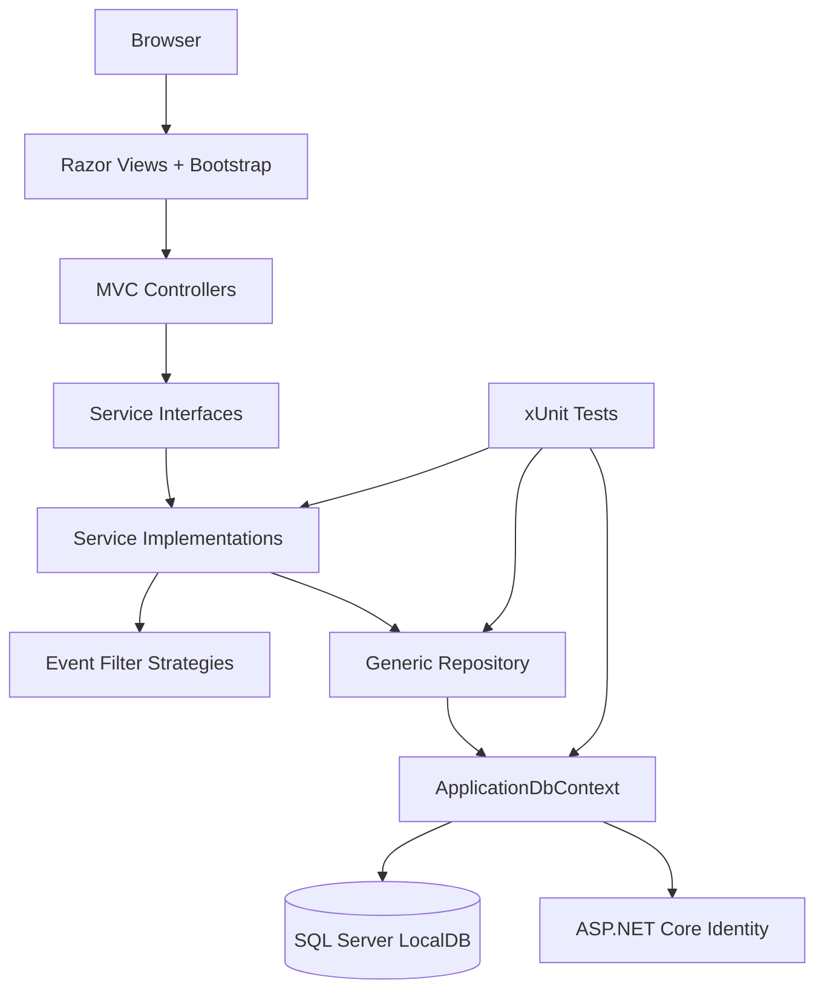

# Architecture Diagram

## Purpose

This document describes the layered architecture of the Community Event Management System.

## Layers

### 1. Browser

- User interacts with Bootstrap-styled Razor pages.
- Sends GET and POST requests to MVC controllers.

### 2. Razor Views

- Views render forms, tables, cards, badges, validation messages, and alerts.
- Views use ViewModels such as:
  - `EventCreateViewModel`
  - `EventEditViewModel`
  - `EventDetailsViewModel`
  - `EventFilterViewModel`
  - `RegistrationViewModel`
  - `AdminDashboardViewModel`

### 3. MVC Controllers

- Controllers handle HTTP flow only.
- Controllers map between domain objects and ViewModels.
- Controllers call service interfaces.
- Controllers do not use `ApplicationDbContext` directly.

Implemented controller examples:

- `AdminEventsController`
- `AdminVenuesController`
- `AdminActivitiesController`
- `AdminParticipantsController`
- `AdminRegistrationsController`
- `EventsController`
- `MyRegistrationsController`

### 4. Service Interfaces

- Service interfaces support abstraction, dependency injection, and unit testing.
- Examples:
  - `IEventService`
  - `IRegistrationService`
  - `IVenueService`
  - `IActivityService`
  - `IParticipantService`
  - `IAdminDashboardService`

### 5. Service Implementations

- Services contain business logic and validation.
- Examples:
  - Event creation and event assignment management
  - Duplicate registration checking
  - Venue capacity checking
  - Registration confirmation/cancellation
  - Dashboard summary generation

### 6. Strategy Pattern

- `IEventFilterStrategy` defines polymorphic event filtering.
- Implementations:
  - `DateFilterStrategy`
  - `VenueFilterStrategy`
  - `ActivityFilterStrategy`
  - `SearchTermFilterStrategy`
- `EventService` applies each strategy to an `IQueryable<Event>`.

### 7. Generic Repository

- `IRepository<T>` abstracts common data access.
- `Repository<T>` uses EF Core `DbSet<T>`.
- Services depend on repositories rather than `ApplicationDbContext`.

### 8. ApplicationDbContext

- Inherits from `IdentityDbContext`.
- Preserves ASP.NET Core Identity.
- Configures domain entities and relationships.
- Configures many-to-many junction tables and indexes.

### 9. SQL Server LocalDB

- Stores application data through EF Core.
- Uses migrations for database schema.

## Supporting Concerns

- **ASP.NET Core Identity**
  - Handles login, registration, authentication, and roles.
  - Roles include `Admin` and `User`.

- **Bootstrap UI**
  - Provides responsive cards, forms, tables, buttons, alerts, and badges.

- **EF Core Migrations**
  - Maintains database schema for Identity and domain models.

- **xUnit Tests**
  - Tests service-layer behavior.
  - Uses EF Core InMemory database.
  - Covers normal cases, edge cases, validation failures, and exception paths.

## Mermaid Architecture Sketch



## Architectural Rule

Controllers do not use `ApplicationDbContext` directly. Data access flows through:

```text
Controller -> Service Interface -> Service Implementation -> IRepository<T> -> Repository<T> -> ApplicationDbContext -> SQL Server LocalDB
```
