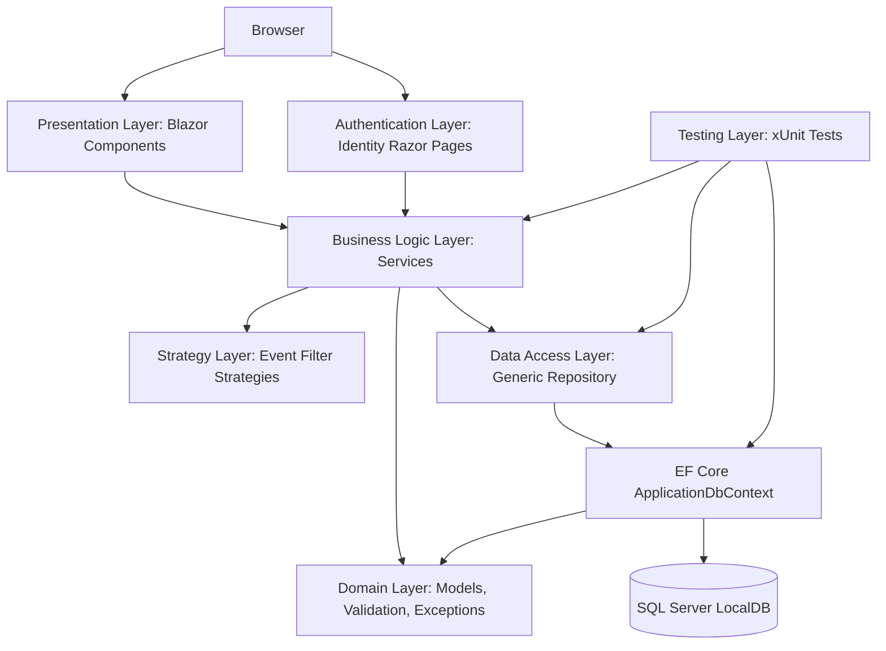

# Architecture Diagram

## Purpose

This document describes the layered architecture of the Community Event Management System as implemented in the final Blazor-first application.

## Layers

### 1. Browser

- Users interact with Bootstrap-styled Blazor pages.
- Main event-management workflows run through interactive Razor components.

### 2. Presentation Layer: Blazor Components

- Blazor components render forms, tables, cards, badges, validation messages, and alerts.
- Main user-facing components:
  - `Components/Pages/Home.razor`
  - `Components/Pages/Events.razor`
  - `Components/Pages/EventDetails.razor`
  - `Components/Pages/MyRegistrations.razor`
- Main admin components:
  - `Components/Pages/Admin/Dashboard.razor`
  - `Components/Pages/Admin/Events.razor`
  - `Components/Pages/Admin/Registrations.razor`
  - `Components/Pages/Admin/Participants.razor`
  - `Components/Pages/Admin/Venues.razor`
  - `Components/Pages/Admin/Activities.razor`
- Components use ViewModels such as `EventCreateViewModel`, `EventEditViewModel`, `EventFilterViewModel`, `ParticipantViewModel`, `VenueViewModel`, `ActivityViewModel`, and `AdminDashboardViewModel`.

### 3. Authentication Layer: ASP.NET Core Identity Razor Pages

- ASP.NET Core Identity Razor Pages are retained for authentication pages such as login, register, and logout.
- Identity provides authentication, email confirmation support, and role-based authorization.
- The application seeds `Admin` and `User` roles.

### 4. Business Logic Layer: Services

- Services contain business rules and validation.
- Examples:
  - `EventService`
  - `RegistrationService`
  - `VenueService`
  - `ActivityService`
  - `ParticipantService`
  - `AdminDashboardService`
- Blazor components depend on service interfaces instead of querying `ApplicationDbContext` directly.

### 5. Strategy Layer: Event Filtering

- `IEventFilterStrategy` defines polymorphic event filtering.
- Implementations:
  - `DateFilterStrategy`
  - `VenueFilterStrategy`
  - `ActivityFilterStrategy`
  - `SearchTermFilterStrategy`
- `EventService` applies each strategy to an `IQueryable<Event>`.

### 6. Data Access Layer: Repository Pattern with EF Core DbContext

- `IRepository<T>` abstracts common data access.
- `Repository<T>` uses EF Core `DbSet<T>`.
- `ApplicationDbContext` inherits from `IdentityDbContext`.
- EF Core maps domain entities, relationships, indexes, and delete behavior.

### 7. Domain Layer: Models, Validation, and Custom Exceptions

- Domain models include `Event`, `Participant`, `Venue`, `Activity`, `Registration`, `EventVenue`, and `EventActivity`.
- Validation is implemented with ViewModel data annotations, custom validation attributes, entity validation methods, service-level checks, and custom exceptions.
- Custom exceptions provide safe user-facing error messages.

### 8. Testing Layer: xUnit Tests

- xUnit tests target the service layer.
- Tests use EF Core InMemory databases.
- Coverage focuses on filtering, registration rules, safe deletes, validation, and exception paths.

## Mermaid Architecture Sketch



## Architectural Rule

Blazor components do not use `ApplicationDbContext` directly. Data access flows through:

```text
Blazor Component -> Service Interface -> Service Implementation -> IRepository<T> -> Repository<T> -> ApplicationDbContext -> SQL Server LocalDB
```

ASP.NET Core Identity Razor Pages are retained for authentication pages such as login, register, and logout. The main event management workflows are implemented using Blazor components.
