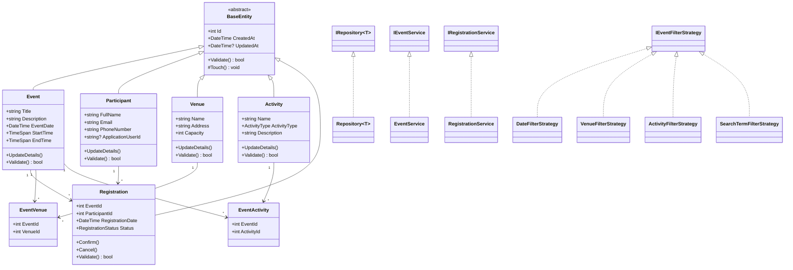

# Class Diagram

## Purpose

This document describes the main domain, repository, service, and strategy classes implemented in the Community Event Management System. It is suitable for conversion into a UML class diagram.

## Domain Classes

### BaseEntity

- `abstract class BaseEntity`
- Properties:
  - `int Id`
  - `DateTime CreatedAt`
  - `DateTime? UpdatedAt`
- Methods:
  - `virtual bool Validate()`
  - `protected void Touch()`

### Event : BaseEntity

- Properties:
  - `string Title`
  - `string Description`
  - `DateTime EventDate`
  - `TimeSpan StartTime`
  - `TimeSpan EndTime`
  - `ICollection<Registration> Registrations`
  - `ICollection<EventVenue> EventVenues`
  - `ICollection<EventActivity> EventActivities`
- Methods:
  - `UpdateDetails(...)`
  - `override bool Validate()`

### Participant : BaseEntity

- Properties:
  - `string FullName`
  - `string Email`
  - `string PhoneNumber`
  - `string? ApplicationUserId`
  - `ICollection<Registration> Registrations`
- Methods:
  - `UpdateDetails(...)`
  - `override bool Validate()`

### Venue : BaseEntity

- Properties:
  - `string Name`
  - `string Address`
  - `int Capacity`
  - `ICollection<EventVenue> EventVenues`
- Methods:
  - `UpdateDetails(...)`
  - `override bool Validate()`

### Activity : BaseEntity

- Properties:
  - `string Name`
  - `ActivityType ActivityType`
  - `string Description`
  - `ICollection<EventActivity> EventActivities`
- Methods:
  - `UpdateDetails(...)`
  - `override bool Validate()`

### Registration : BaseEntity

- Properties:
  - `int EventId`
  - `int ParticipantId`
  - `DateTime RegistrationDate`
  - `RegistrationStatus Status`
  - `Event Event`
  - `Participant Participant`
- Methods:
  - `Confirm()`
  - `Cancel()`
  - `override bool Validate()`

### EventVenue

- Junction model for Event-Venue many-to-many relationship.
- Properties:
  - `int EventId`
  - `int VenueId`
  - `Event Event`
  - `Venue Venue`

### EventActivity

- Junction model for Event-Activity many-to-many relationship.
- Properties:
  - `int EventId`
  - `int ActivityId`
  - `Event Event`
  - `Activity Activity`

### Enums

- `RegistrationStatus`
  - `Pending`
  - `Confirmed`
  - `Cancelled`

- `ActivityType`
  - `Workshop`
  - `Talk`
  - `Game`
  - `Seminar`
  - `Training`
  - `Networking`
  - `Other`

## Repository Pattern

### IRepository<T>

- Generic interface where `T : BaseEntity`
- Methods:
  - `Task<T?> GetByIdAsync(int id)`
  - `Task<List<T>> GetAllAsync()`
  - `IQueryable<T> Query()`
  - `Task AddAsync(T entity)`
  - `void Update(T entity)`
  - `void Delete(T entity)`
  - `Task<bool> ExistsAsync(int id)`
  - `Task<int> CountAsync()`
  - `Task SaveChangesAsync()`

### Repository<T> : IRepository<T>

- Uses `ApplicationDbContext`
- Uses `DbSet<T>`
- Provides reusable EF Core data access.

## Service Layer

### IEventService / EventService

- Important methods:
  - `GetUpcomingEventsAsync()`
  - `GetUpcomingEventsAsync(DateTime fromDate)`
  - `GetFilteredUpcomingEventsAsync(EventFilterViewModel filter)`
  - `GetEventDetailsAsync(int eventId)`
  - `CreateEventAsync(Event eventItem)`
  - `CreateEventAsync(Event eventItem, IEnumerable<int> venueIds, IEnumerable<int> activityIds)`
  - `UpdateEventAsync(Event eventItem)`
  - `UpdateEventAsync(Event eventItem, IEnumerable<int> venueIds, IEnumerable<int> activityIds)`
  - `DeleteEventAsync(int eventId)`
  - `GetTotalEventsCountAsync()`

### IRegistrationService / RegistrationService

- Important methods:
  - `RegisterAsync(int eventId, int participantId)`
  - `CancelRegistrationAsync(int registrationId, int participantId)`
  - `CancelRegistrationByAdminAsync(int registrationId)`
  - `ConfirmRegistrationAsync(int registrationId)`
  - `GetRegistrationAsync(int registrationId)`
  - `GetParticipantRegistrationsAsync(int participantId)`
  - `GetEventRegistrationsAsync(int eventId)`
  - `GetRecentRegistrationsAsync(int count)`
  - `GetRegistrationSummaryAsync()`

### Other Management Services

- `IVenueService` / `VenueService`
- `IActivityService` / `ActivityService`
- `IParticipantService` / `ParticipantService`
- `IAdminDashboardService` / `AdminDashboardService`

## Strategy Pattern

### IEventFilterStrategy

- Method:
  - `IQueryable<Event> Apply(IQueryable<Event> events, EventFilterViewModel filter)`

### Implementations

- `DateFilterStrategy`
- `VenueFilterStrategy`
- `ActivityFilterStrategy`
- `SearchTermFilterStrategy`

Each strategy applies one filtering algorithm and is called polymorphically by `EventService`.

## Multiplicities

- `Event 1..* Registration`
- `Participant 1..* Registration`
- `Event 1..* EventVenue`
- `Venue 1..* EventVenue`
- `Event 1..* EventActivity`
- `Activity 1..* EventActivity`

## Mermaid Class Diagram Sketch

