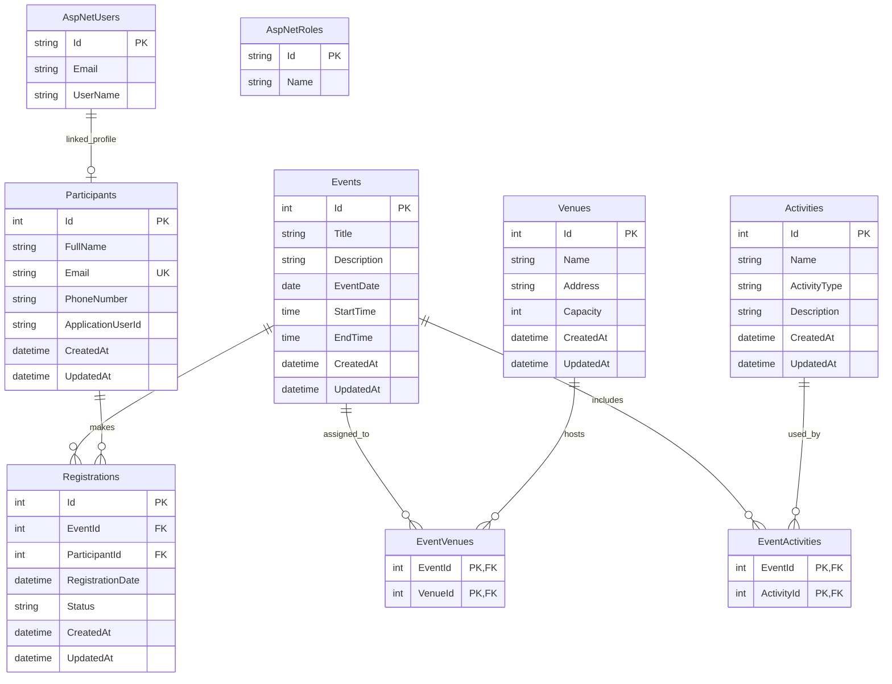

# Entity Relationship Diagram

## Purpose

This document describes the implemented database structure for the Community Event Management System, including domain tables and ASP.NET Core Identity tables.

## Main Tables

### Events

- Primary key:
  - `Id`
- Columns:
  - `Title`
  - `Description`
  - `EventDate`
  - `StartTime`
  - `EndTime`
  - `CreatedAt`
  - `UpdatedAt`

### Participants

- Primary key:
  - `Id`
- Columns:
  - `FullName`
  - `Email`
  - `PhoneNumber`
  - `ApplicationUserId`
  - `CreatedAt`
  - `UpdatedAt`
- Notes:
  - `Email` has a unique index.
  - `ApplicationUserId` links a participant profile to an ASP.NET Core Identity user where available.

### Venues

- Primary key:
  - `Id`
- Columns:
  - `Name`
  - `Address`
  - `Capacity`
  - `CreatedAt`
  - `UpdatedAt`
- Constraint:
  - `Capacity > 0`

### Activities

- Primary key:
  - `Id`
- Columns:
  - `Name`
  - `ActivityType`
  - `Description`
  - `CreatedAt`
  - `UpdatedAt`
- Notes:
  - `ActivityType` is stored consistently as a configured enum value.

### Registrations

- Primary key:
  - `Id`
- Foreign keys:
  - `EventId` references `Events.Id`
  - `ParticipantId` references `Participants.Id`
- Columns:
  - `RegistrationDate`
  - `Status`
  - `CreatedAt`
  - `UpdatedAt`
- Index:
  - Unique composite index on `EventId + ParticipantId`
- Purpose:
  - Junction table for Event-Participant many-to-many relationship.
  - Also stores registration-specific data such as date and status.

### EventVenues

- Composite primary key:
  - `EventId + VenueId`
- Foreign keys:
  - `EventId` references `Events.Id`
  - `VenueId` references `Venues.Id`
- Purpose:
  - Junction table for Event-Venue many-to-many relationship.

### EventActivities

- Composite primary key:
  - `EventId + ActivityId`
- Foreign keys:
  - `EventId` references `Events.Id`
  - `ActivityId` references `Activities.Id`
- Purpose:
  - Junction table for Event-Activity many-to-many relationship.

## ASP.NET Core Identity Tables

### AspNetUsers

- Stores login accounts.
- Used by Identity registration/login.
- Participants can optionally link to Identity users through `Participants.ApplicationUserId`.

### AspNetRoles

- Stores application roles.
- Seeded roles:
  - `Admin`
  - `User`

### Other Identity Tables

The standard Identity schema also includes role claims, user claims, user logins, user roles, user tokens, and related authentication tables.

## Relationship Summary

- `Events` many-to-many `Participants` through `Registrations`
- `Events` many-to-many `Venues` through `EventVenues`
- `Events` many-to-many `Activities` through `EventActivities`
- `AspNetUsers` optionally connects to `Participants` through `Participants.ApplicationUserId`

## Mermaid ERD Sketch

