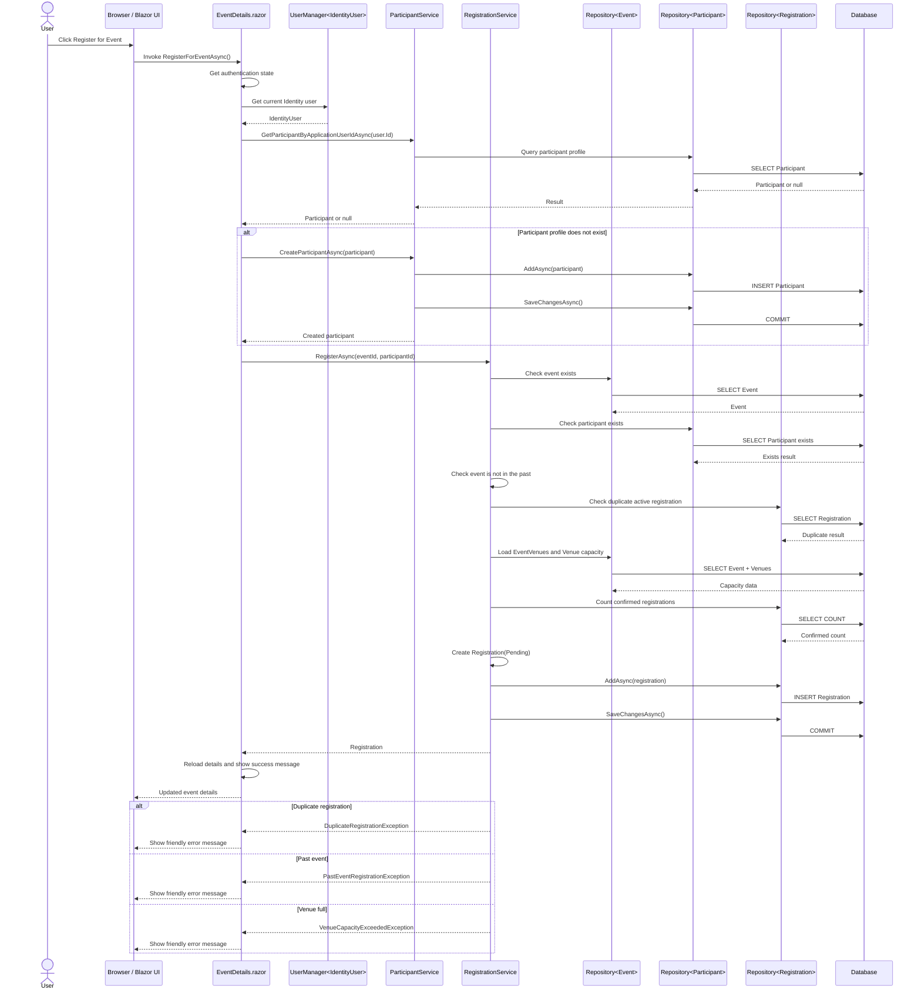

# Sequence Diagram: Register For Event

## Purpose

This document describes the user registration workflow implemented in the Blazor-first application.

## Participants

- User
- Browser / Blazor component
- `Components/Pages/EventDetails.razor`
- `UserManager<IdentityUser>`
- `ParticipantService`
- `RegistrationService`
- `Repository<Event>`
- `Repository<Participant>`
- `Repository<Registration>`
- Database

## Main Flow

1. User opens `Components/Pages/EventDetails.razor` at `/events/{id:int}`.
2. User clicks **Register for Event**.
3. `EventDetails.razor` gets the current authentication state.
4. `EventDetails.razor` uses `UserManager<IdentityUser>` to get the current logged-in Identity user.
5. `EventDetails.razor` calls `ParticipantService.GetParticipantByApplicationUserIdAsync`.
6. If no participant profile exists:
   - The component creates a `Participant` using the Identity user's email.
   - The component calls `ParticipantService.CreateParticipantAsync`.
   - Participant data is saved through `Repository<Participant>`.
7. The component calls `RegistrationService.RegisterAsync(eventId, participantId)`.
8. `RegistrationService` checks that the event exists through `Repository<Event>`.
9. `RegistrationService` checks that the participant exists through `Repository<Participant>`.
10. `RegistrationService` checks that the event is not in the past.
11. `RegistrationService` checks that there is no duplicate active registration.
12. `RegistrationService` checks venue capacity.
13. `RegistrationService` creates a new `Registration`.
14. `Repository<Registration>` adds the registration and saves changes.
15. `EventDetails.razor` reloads event details and displays a success message.

## Alternate Flows

### Duplicate Registration

- If an active registration already exists for the same event and participant:
  - `RegistrationService` throws `DuplicateRegistrationException`.
  - `EventDetails.razor` catches `AppException`.
  - The component displays a friendly registration error message.

### Past Event

- If the event date is before today:
  - `RegistrationService` throws `PastEventRegistrationException`.
  - The component displays a friendly registration error message.

### Venue Full

- If the event has venue assignments and confirmed registrations meet the smallest venue capacity:
  - `RegistrationService` throws `VenueCapacityExceededException`.
  - The component displays a friendly registration error message.

## Mermaid Sequence Sketch

