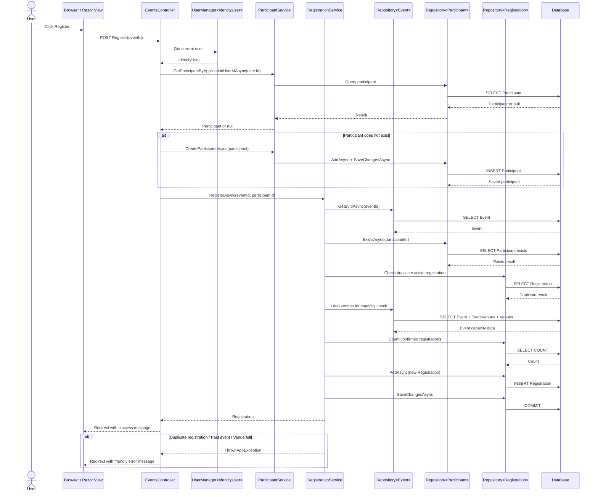

# Sequence Diagram: Register For Event

## Purpose

This document describes the user registration workflow implemented in the MVC application.

## Participants

- Browser / Razor View
- `EventsController`
- `UserManager<IdentityUser>`
- `ParticipantService`
- `RegistrationService`
- `Repository<Event>`
- `Repository<Participant>`
- `Repository<Registration>`
- Database

## Main Flow

1. User opens an event details page.
2. User clicks **Register**.
3. Browser posts the registration form to `EventsController.Register`.
4. `EventsController` uses `UserManager<IdentityUser>` to get the current logged-in Identity user.
5. `EventsController` calls `ParticipantService.GetParticipantByApplicationUserIdAsync`.
6. If no participant profile exists:
   - Controller creates a `Participant` using the Identity user's email.
   - Controller calls `ParticipantService.CreateParticipantAsync`.
   - Participant is saved through `Repository<Participant>`.
7. Controller calls `RegistrationService.RegisterAsync(eventId, participantId)`.
8. `RegistrationService` checks that the event exists through `Repository<Event>`.
9. `RegistrationService` checks that the participant exists through `Repository<Participant>`.
10. `RegistrationService` checks that the event is not in the past.
11. `RegistrationService` checks that there is no duplicate active registration.
12. `RegistrationService` checks venue capacity.
13. `RegistrationService` creates a new `Registration`.
14. `Repository<Registration>` adds the registration and saves changes.
15. Controller sets a success message and redirects to **My Registrations**.

## Alternate Flows

### Duplicate Registration

- If an active registration already exists for the same event and participant:
  - `RegistrationService` throws `DuplicateRegistrationException`.
  - Controller catches `AppException`.
  - Controller stores a friendly error in `TempData["Error"]`.
  - User is redirected back to event details.

### Past Event

- If the event date is before today:
  - `RegistrationService` throws `PastEventRegistrationException`.
  - Controller shows a friendly error message.

### Venue Full

- If the event has venue assignments and confirmed registrations meet the smallest venue capacity:
  - `RegistrationService` throws `VenueCapacityExceededException`.
  - Controller shows a friendly error message.

## Mermaid Sequence Sketch

