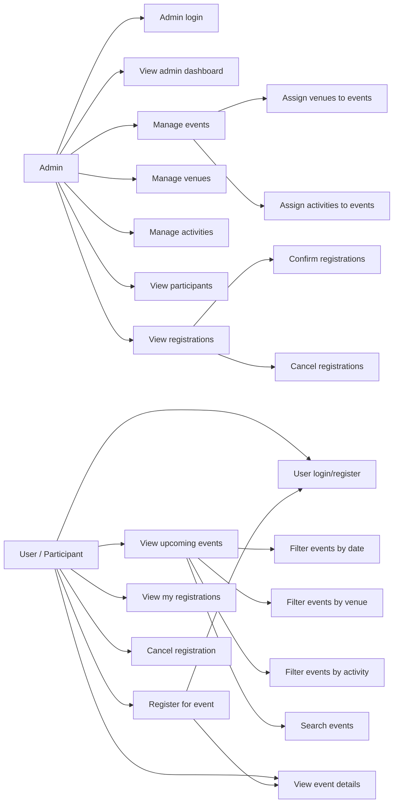

# Use Case Diagram

## Purpose

This document describes the main actors and use cases for the Community Event Management System. It is based on the implemented ASP.NET Core MVC application.

## Actors

- **Admin**
  - Authenticated staff user with the `Admin` role.
  - Manages events, venues, activities, participants, registrations, and dashboard information.

- **User / Participant**
  - Public visitor or authenticated user.
  - Browses upcoming events, filters events, registers for events, and manages personal registrations.

## Use Cases

### Admin Use Cases

- Admin login
- Manage events
- Assign venues to events
- Assign activities to events
- Manage venues
- Manage activities
- View participants
- View registrations
- Confirm registrations
- Cancel registrations
- View admin dashboard

### User / Participant Use Cases

- User login/register
- View upcoming events
- Filter events by date
- Filter events by venue
- Filter events by activity
- Search events
- View event details
- Register for event
- View my registrations
- Cancel registration

## Include / Extend Relationships

- **Manage events** includes:
  - Create event
  - Edit event
  - Delete event
  - Assign venues to events
  - Assign activities to events

- **View upcoming events** may include:
  - Filter events by date
  - Filter events by venue
  - Filter events by activity
  - Search events

- **Register for event** includes:
  - User login/register
  - View event details
  - Validate event availability
  - Check duplicate registration
  - Check venue capacity

- **View registrations** may extend to:
  - Confirm registrations
  - Cancel registrations

## Mermaid Use Case Sketch

